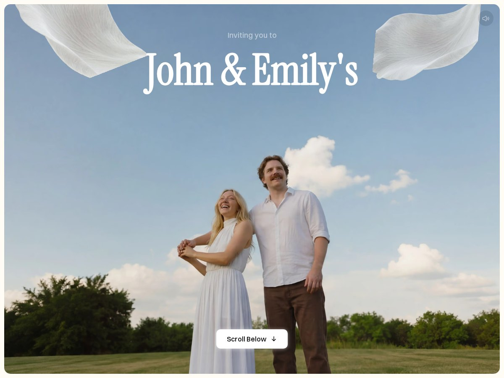
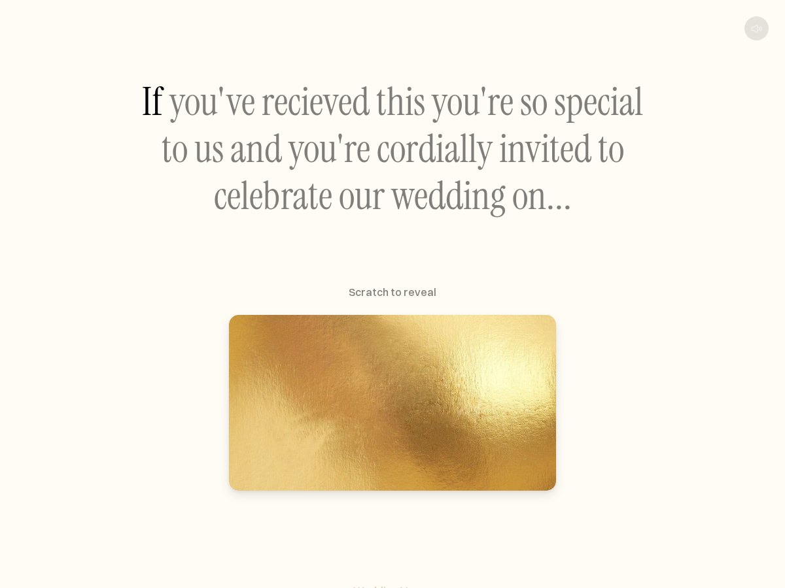
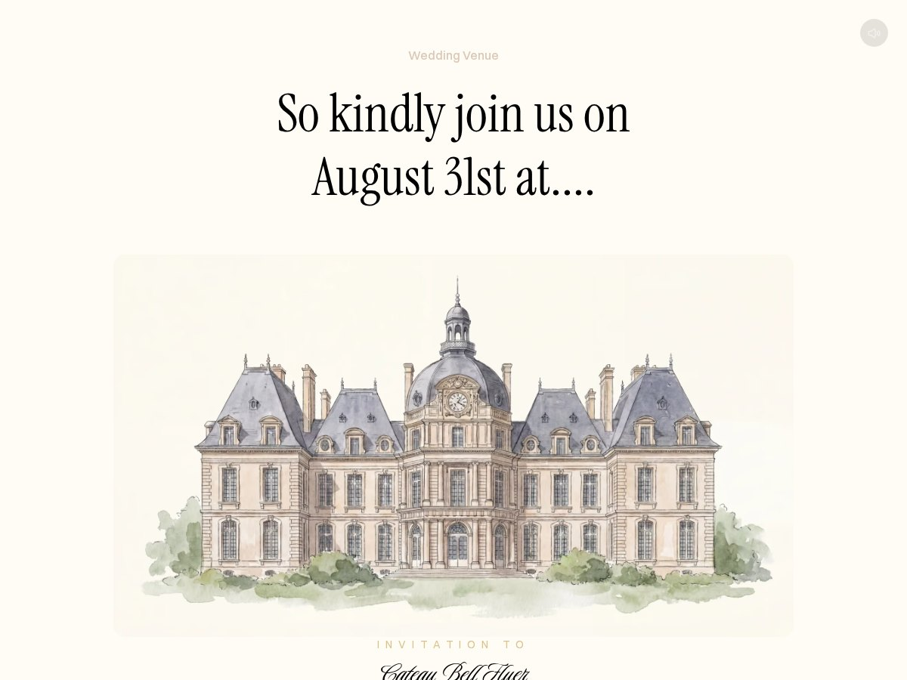
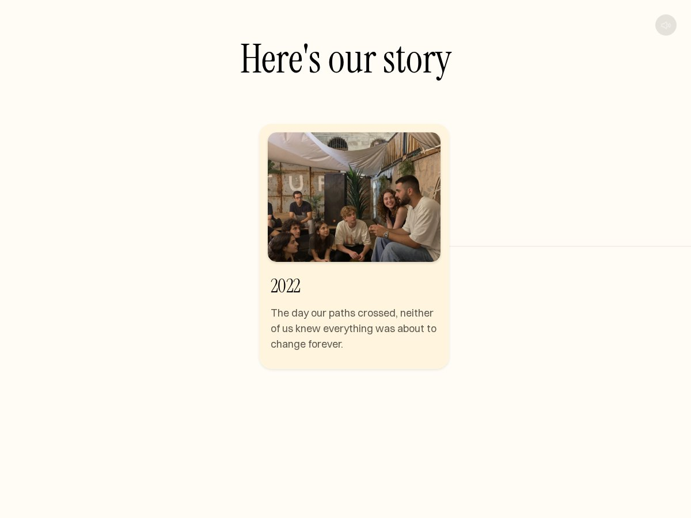
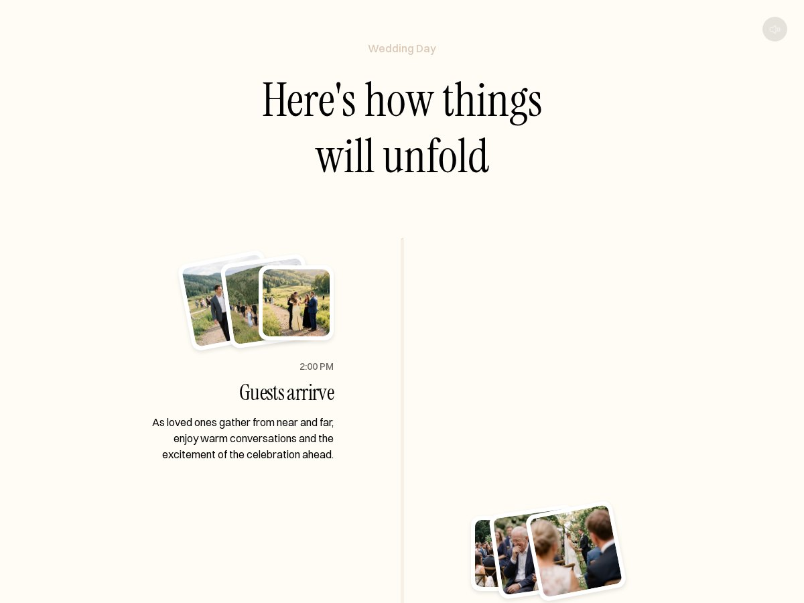
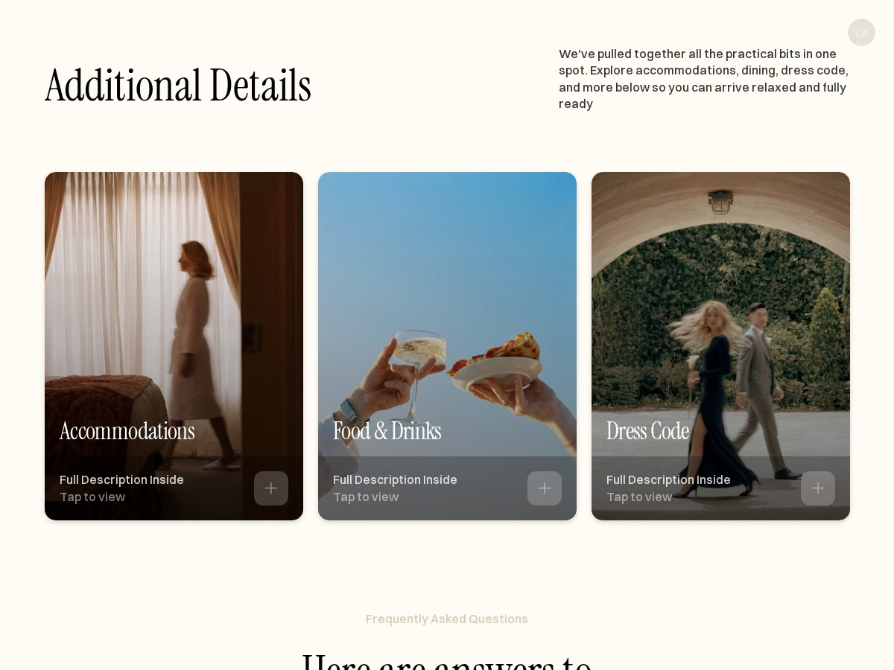
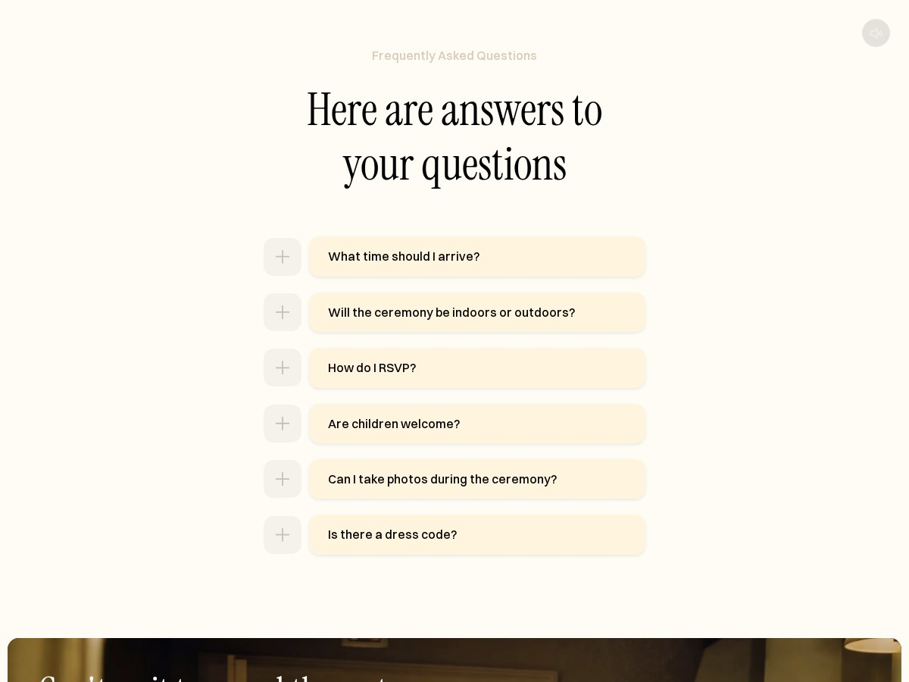
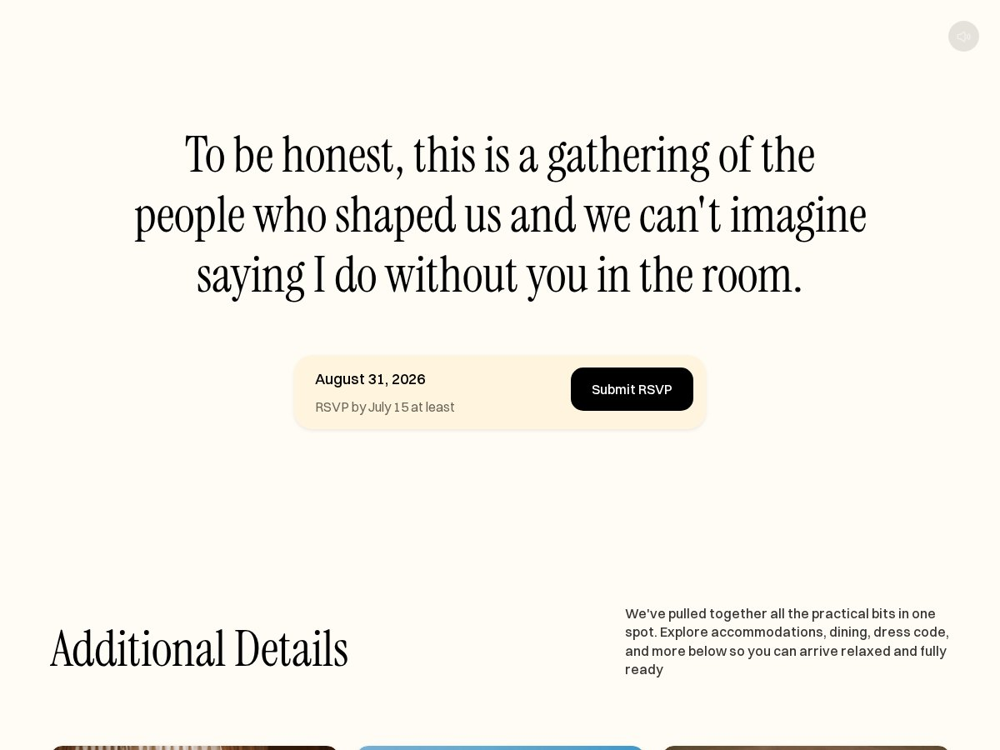
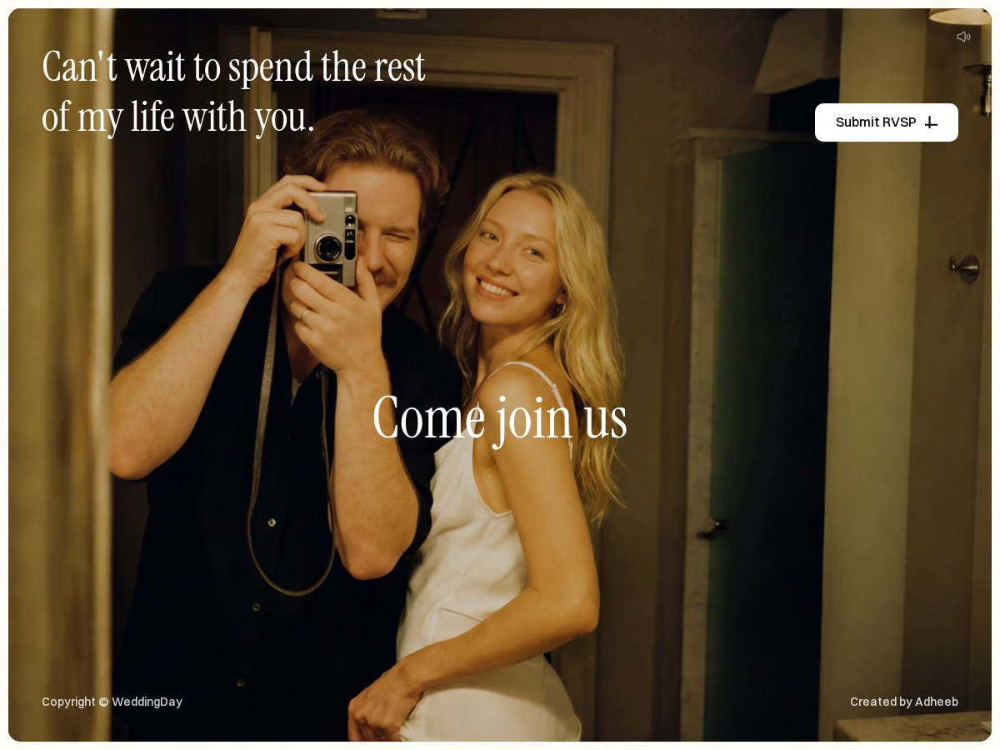

<p align="center">
  
</p>

<h1 align="center">John &amp; Emily — Wedding Invitation</h1>

<p align="center">
  An elegant one-page wedding invitation.<br/>
  <a href="https://component.hypeer.cloud/mariage/"><strong>View the live site →</strong></a>
</p>

<p align="center">
  
  
  
  
</p>

---

A refined digital invitation for **John & Emily**, built as a single immersive page.
Serif display typography, a full-screen hero, a scratch-to-reveal date card, a
scroll-driven story, the wedding timeline, practical details and an FAQ.

The experience is fully client-side: no backend, no CMS, no third-party runtime.

## Highlights

- **Full-screen hero** — cinematic photo, staggered letter reveal, floating petals and
  an ambient soundtrack with a sound toggle.
- **Scratch card** — canvas-based scratch layer that reveals the wedding date and a
  live countdown.
- **Scroll-driven story** — a sticky horizontal gallery that moves with the page.
- **Timeline** — six moments of the day, alternating layout and a progress line tied
  to the scroll position.
- **RSVP call-to-actions** — repeated at the venue, mid-page and in the footer, linking to a three-step RSVP page at `/rsvp`.
- **Detail panels** — accommodation, food and dress-code cards open an accessible modal.
- **Details & FAQ** — three detail cards and an accessible accordion.
- **Motion with restraint** — IntersectionObserver reveals, transform/opacity-only
  animations, reduced layout work on scroll.

## Sections

<table>
  <tr>
    <td width="50%"></td>
    <td width="50%"></td>
  </tr>
  <tr>
    <td align="center"><sub><b>Invitation &amp; scratch card</b> — reveal the date</sub></td>
    <td align="center"><sub><b>The venue</b> — Château Belle Fleur, Lake Como</sub></td>
  </tr>
  <tr>
    <td></td>
    <td></td>
  </tr>
  <tr>
    <td align="center"><sub><b>Our story</b> — a horizontal, scroll-linked gallery</sub></td>
    <td align="center"><sub><b>The day</b> — from arrival to the last dance</sub></td>
  </tr>
  <tr>
    <td></td>
    <td></td>
  </tr>
  <tr>
    <td align="center"><sub><b>Details</b> — accommodation, food &amp; dress code</sub></td>
    <td align="center"><sub><b>FAQ</b> — answers to the questions guests ask</sub></td>
  </tr>
</table>

<p align="center">
  
</p>

<p align="center">
  
</p>

## Tech stack

| Layer | Choice |
|---|---|
| UI | React 18 + TypeScript |
| Bundler | esbuild (single bundle, hashed assets) |
| Styling | hand-written CSS, custom properties, no UI framework |
| Media | local AVIF/WebP images, MP4 background, MP3 soundtrack |
| Icons | inline SVG / CSS masks |
| Verification | Playwright + Chromium, pixel diff at 1200×900 |

No runtime dependency beyond React. Fonts are self-hosted (Instrument Serif,
Switzer, Luxurious Script, Inter).

## Getting started

```bash
npm install
node scripts/build.mjs      # production build → dist/
node scripts/serve.mjs 8080 # preview → http://127.0.0.1:8080
```

## Project structure

```
.
├── src/
│   ├── components/     Hero, Intro, Venue, Story, Timeline,
│   │                   RsvpIntro, Details, Faq, Footer
│   ├── hooks/          useReveal — IntersectionObserver reveals
│   ├── styles/         global.css, shared.css
│   ├── rsvp.tsx        three-step RSVP page (mounted at /rsvp)
│   ├── rsvp.css
│   ├── App.tsx
│   └── main.tsx
├── rsvp.html
├── assets/             fonts, images, video, audio
├── scripts/            build.mjs, serve.mjs
├── docs/screenshots/   README captures
└── index.html
```

## Design notes

- Typography scale: 100/120 display, 70/84 section titles, 60/72 editorial quotes,
  32/38 cards, 18/27 body, 16/22 UI.
- Palette: warm paper `#fffcf5`, champagne `#fff5de`, sand `#dbc8b6`, ink `#000`.
- The page is composed for a 1200 px artboard (the reference composition), with
  fluid containers around the fixed content columns.
- Every section is a self-contained component with its own stylesheet; the page is
  assembled in `src/App.tsx`.

## Accessibility

- Semantic landmarks (`header`, `main` content sections, `footer`, `h1–h5`).
- Sound control exposes an accessible label; FAQ buttons expose open/close state.
- Decorative imagery is `alt=""`; meaningful photos carry descriptive alt text.
- Motion is limited to opacity/transform; content remains visible without animation.

## Deployment

The production build is a static bundle. Upload `dist/` to any static host; the
demo is served over HTTPS at
[component.hypeer.cloud/mariage](https://component.hypeer.cloud/mariage/).

## License

Personal project — all wedding photography and music remain the property of their
respective owners.